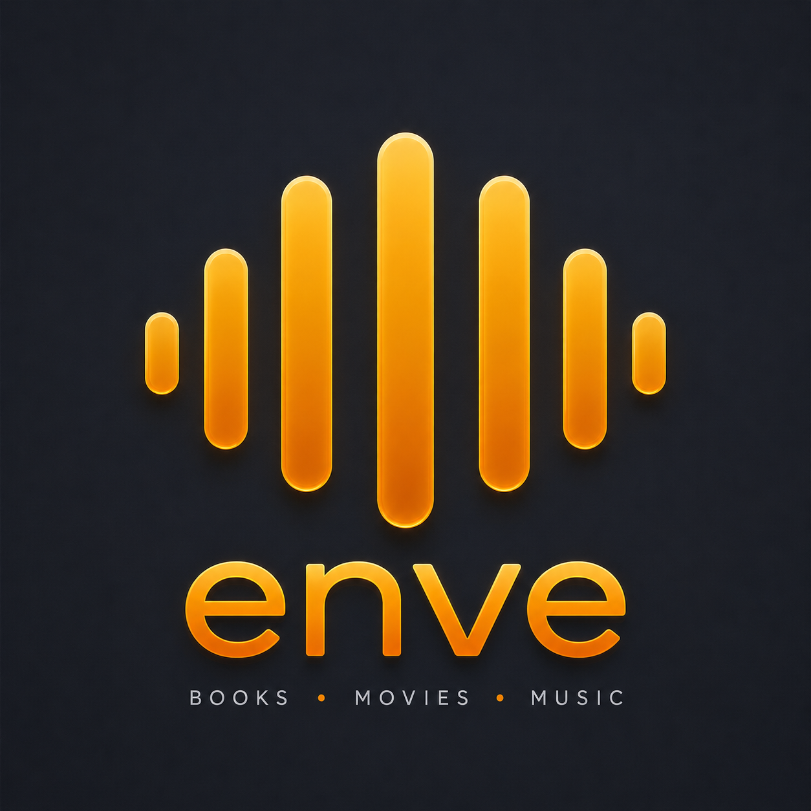

  

<h1 align="center">Enve Support</h1>

  Bugs, questions, feature requests, known issues, and updates for everything Enve.

  
  
  
  
  

---

## What Enve is

This is the main support repo for all the Enve apps. There is a lot more here than just the book player now: books, music, video, retro games, tabletop stuff, and notes.

Everything is free. There is no Enve account, subscription, advertising, or analytics. I build these around the servers, files, and libraries you already have—not around another service you need to sign up for.

Your stuff stays on your device or goes straight to the service you connected. Server passwords and tokens are kept in iOS Keychain or Android encrypted storage. I do not run a cloud service that sits in the middle of that.

| App | Platforms and current availability | What it is for |
| --- | --- | --- |
| [Enve Book Player](https://envemedia.com/books/) | iOS TestFlight · Android open testing | Audiobooks, ebooks, comics, and podcasts from your own libraries and servers. |
| [Enve Music Player](https://envemedia.com/music/) | iOS TestFlight · Android in development | Plex Music, Jellyfin, Subsonic, WebDAV, local files, and more. |
| [Enve Video Player](https://envemedia.com/videos/) | iOS TestFlight · Android closed testing | Plex, Jellyfin, Emby, Silo, WebDAV, local files, and more. |
| [Enve RomM Player](https://envemedia.com/romm/) | iOS TestFlight · Android testing | Retro games from your own RomM server or your own game files. |
| [Enve Game Master](https://envemedia.com/game-master/) | iOS TestFlight | A D&amp;D companion and local-AI Dungeon Master for campaigns. |
| [Enve Notes](https://envemedia.com/notes/) | iOS · in development | Local Markdown notes, journals, tags, wikilinks, handwriting, and media captures. |

Some of these are still early and availability moves around while I am building them. The linked pages are where I keep the current download and TestFlight information.

## The stuff it connects to

The whole point is that you can use your own setup. You are not locked into one server or one Enve cloud.

- **Books:** Audiobookshelf, Plex, Jellyfin, Emby, Komga, Kavita, Grimmory, BookOrbit, Silo, Storyteller, OPDS, WebDAV, RSS podcasts, Premiumize, Real-Debrid, and local files.
- **Music:** Plex, Jellyfin, Subsonic-compatible servers, Premiumize, WebDAV, and local files.
- **Video:** Plex, Jellyfin, Emby, Silo, Premiumize, WebDAV, and local files.
- **Games:** your own RomM server or local game files. Enve does not provide games, ROMs, BIOS files, firmware, encryption keys, or download links.
- **Game Master:** local-network OpenAI-compatible model servers such as LM Studio, Ollama, and llama.cpp.

There are setup guides for servers, sync, reading, playback, downloads, and privacy in the [Enve docs](https://envemedia.com/docs/).

## Need help or want to tell me something?

GitHub is where bugs and fixes get tracked properly. Discord is where I am around day to day. Either one is fine, especially if you are not sure whether something is a bug or just a setup problem.

| If you need to… | Best place |
| --- | --- |
| Something is broken | [Search or open a GitHub issue](https://github.com/opisaac9001/Enve-Support/issues) |
| You have an idea | [Open an issue](https://github.com/opisaac9001/Enve-Support/issues/new) |
| You need help getting set up | [Discord](https://discord.gg/Hw4nmXRehb) or [open an issue](https://github.com/opisaac9001/Enve-Support/issues/new) |
| You want the docs or common answers | [Docs](https://envemedia.com/docs/) and [FAQ](https://envemedia.com/faq.html) |
| You want to see what is going on | [Discord](https://discord.gg/Hw4nmXRehb) |
| You want to help me keep building it | [Buy Me a Coffee](https://buymeacoffee.com/envebookplayer) |

The Enve Librarian bot can turn a Discord support report into a GitHub issue, so nothing useful gets lost in chat.

## If you are reporting a bug

Please have a quick search first in case someone already found it. If not, send as much of this as you can:

- affected app and platform (for example, Book Player on Android)
- app version, device model, and OS version
- connected service and server version, if relevant (such as Plex, Audiobookshelf, RomM, or an OpenAI-compatible local model)
- what you expected and what happened instead
- what you did right before it happened, if you can remember
- screenshots or a short screen recording if it helps show the problem

Please **remove passwords, API keys, tokens, private server addresses, and personal media details** before posting. Crop or blur screenshots if you need to. I will never need your password to look into a bug.

## Known issues and fixes

When I can confirm something is actually broken, I mark it `known-issue`. Issues can also be tagged by app, report type, severity, and whether they came from App Store feedback.

What gets looked at first comes down to how bad it is and how many people it is hitting. Discord reports can record both of those things, which makes it easier to spot the stuff that is really getting in people's way.

If there is a workaround, a fix in testing, or a fix that has shipped, I will update the issue. The code lives in private app repos, but this is where you can see what happened and whether it is fixed.

## A few important notes

- I build Enve independently and it is free to use. Donations are optional; they never unlock features.
- Android and iOS do not always get the same thing at the same time. I call out the important differences on the product pages.
- Enve connects to services you choose. There is no central Enve account, media server, model service, or tracking service.
- With RomM Player, you need to supply your own games and any system files you need to run them.

## Links

- [Enve Media](https://envemedia.com/)
- [Documentation](https://envemedia.com/docs/)
- [FAQ](https://envemedia.com/faq.html)
- [Community on Discord](https://discord.gg/Hw4nmXRehb)
- [Buy Me a Coffee](https://buymeacoffee.com/envebookplayer)
